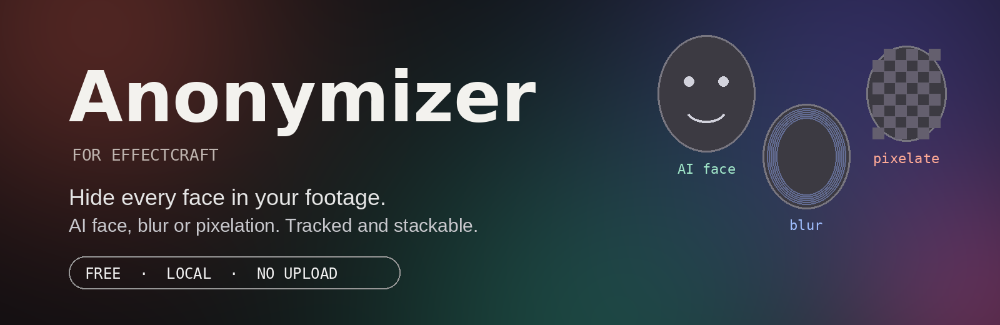
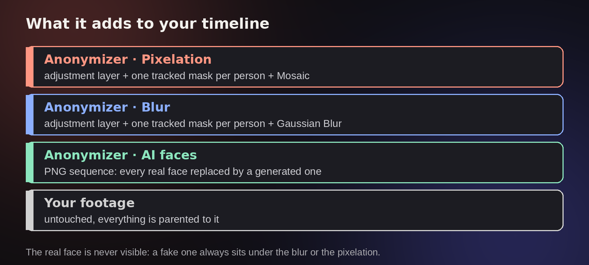
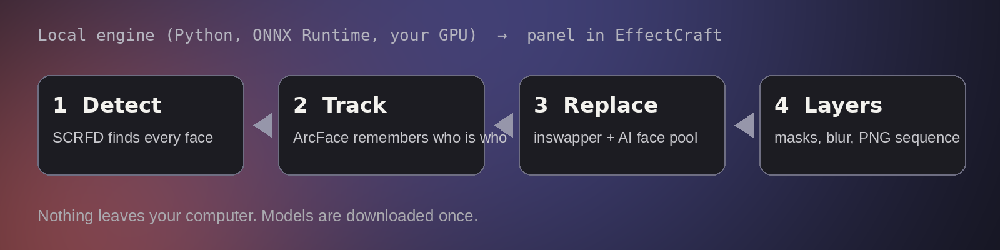

<b>Cache tous les visages de ta vidéo, en un clic.</b> 
Faux visage IA, flou ou pixelisation. Suivi, cumulable, et 100 % local.

<a href="../../releases/latest"><b>⬇ Télécharger</b></a> ·
<a href="README.md">English</a> ·
<a href="NOTICE.md">Licences des modèles</a>

---

## Ce que ça fait

Anonymizer est un panneau pour **[EffectCraft](https://github.com/storytold/effectcraft)** qui trouve **tous les visages** d'un plan, suit chaque personne et la cache. C'est une reconstruction, pour EffectCraft, de l'idée du plug-in *Anonymizer* d'aescripts.

- **Visage IA** : chaque personne est remplacée par un visage généré, du même genre et d'un âge proche. Expressions, éclairage et mouvements sont conservés. Une personne garde le même faux visage pendant tout le plan, même si elle sort du cadre puis revient.
- **Flou** : un flou gaussien suit chaque visage grâce à un masque suivi.
- **Pixelisation** : une mosaïque façon télé suit chaque visage, avec une taille de blocs réglable.
- **Tout se cumule.** Et quand tu coches le flou ou la pixelisation, **un faux visage est toujours glissé dessous** : le vrai visage n'apparaît jamais, même si tu baisses ou retires le flou ensuite.

Tout ce qui est créé est un calque normal, parenté à ta vidéo et modifiable : tu peux déplacer un masque, supprimer celui d'une personne qui n'a pas à être cachée, ou régler le flou dans les options d'effet. Toute l'opération s'annule en un seul Ctrl+Z.

## Comment ça marche

Les scripts EffectCraft ne peuvent pas lancer de programme. L'outil a donc deux parties :

| Partie | Rôle |
|---|---|
| `Anonymizer.jsx` | Le panneau dans EffectCraft. Il crée les calques, les masques et les effets. |
| `moteur/` | Un moteur local en Python (ONNX Runtime, DirectML/CUDA/CPU). Il détecte, suit et génère les visages. Le panneau lui parle sur `127.0.0.1:47811`. |

**Rien ne quitte ton ordinateur.** Les modèles sont téléchargés une seule fois à l'installation. L'outil fonctionne sur EffectCraft tel quel, sans le modifier.

## Installation (Windows)

1. Installe **Python 3.10 à 3.13** depuis [python.org](https://www.python.org/downloads/) en cochant *Add python.exe to PATH*.
2. Télécharge le zip de la dernière version, décompresse-le et copie le dossier `moteur` dans `Documents\Anonymizer\moteur`. Évite `Program Files`.
3. Double-clique sur `installer.bat`. Il installe les bibliothèques et télécharge les modèles IA (environ 1,1 Go, une seule fois). Ta carte graphique est utilisée via DirectML (NVIDIA, AMD ou Intel) ; sans carte compatible, le processeur prend le relais.
4. Dans EffectCraft : **Fichier ▸ Scripts ▸ Installer un panneau ScriptUI…** et choisis `Anonymizer.jsx`. Pour des curseurs bornés, copie aussi `Plug-ins/AnonymizerControls.wasm` dans le dossier `Plug-ins` d'EffectCraft puis relance (facultatif : sans lui, le panneau utilise des curseurs simples).
5. Dans **Réglages ▸ Scripting & Expressions**, coche **Allow Scripts to Write Files and Access Network**. Sans cette option, le panneau ne peut pas joindre le moteur.

macOS et Linux : utilise `installer.sh`, puis `demarrer_moteur.command` (macOS) ou `demarrer_moteur.sh`. Fais d'abord `chmod +x *.sh *.command`.

## Utilisation

1. Double-clique sur `demarrer_moteur.bat` et laisse la fenêtre ouverte.
2. Ouvre **Fenêtre ▸ Anonymizer.jsx** et clique sur **Vérifier**. Le panneau doit afficher « Moteur connecté ».
3. Sélectionne ton calque vidéo, coche les méthodes voulues et clique sur **Anonymiser**.

> **Astuce :** commence par l'option **Zone de travail** sur 2 ou 3 secondes.

Sur un plan de plus de 150 images, le panneau ne fige pas EffectCraft : survole le panneau ou clique sur *Vérifier* pour suivre l'avancement, et les calques se créent à la fin.

## Vitesse

La version 1.1 ajoute un **mode rapide** (activé par défaut, onglet *Détection*) :

- les visages sont détectés une image sur deux, les images intermédiaires sont interpolées ;
- sous un flou ou une pixelisation, le visage IA n'est recalculé qu'une image sur trois, puis recollé à la position suivie entre-temps, et la restauration HD (inutile à cet endroit) est coupée ;
- sous un flou ou une pixelisation, une tache très floue de la zone du visage d'origine est aussi posée sous le faux visage : même si le remplacement rate un visage (coupé par le bord, de profil, minuscule), aucun détail réel ne reste sous le flou ;
- les fichiers PNG s'écrivent en parallèle pendant le calcul de l'image suivante.

Sur un test de 30 images avec quatre personnes, sur processeur seul, le calcul passe de **167 s à 59 s** avec le même rendu. Avec l'ancien réglage par défaut (HD activée), le même test prenait **392 s** : le gain est d'environ **6,5 fois**. Une carte graphique est bien plus rapide encore.

## Bon à savoir

- **Formats** : le moteur lit les vidéos avec OpenCV (H.264, HEVC, ProRes, VP9, AV1…) et les séquences PNG, JPEG, TIFF ou BMP. Il travaille sur le fichier source : les effets appliqués au calque ne sont pas pris en compte.
- Le remappage temporel n'est pas géré. L'étirement temporel et le rognage le sont.
- Un visage raté (petit, flou, de profil) ? Monte la **Sensibilité** ou baisse **Visage minimal** dans l'onglet *Détection*.
- Mets tes propres portraits (un visage par image) dans `moteur/faces/` pour les utiliser comme visages de remplacement.
- Le moteur peut tourner seul, pour tester :
  `python anonymizer_engine.py run --input clip.mp4 --swap --detect-stride 2`

## Licences

Le code est sous licence **MIT**. Les modèles de détection et de remplacement sont publiés par InsightFace pour un **usage de recherche non commercial**. Lis [NOTICE.md](NOTICE.md) avant tout usage commercial.

Utilise Anonymizer pour **protéger** les personnes que tu filmes, jamais pour te faire passer pour quelqu'un d'autre.
