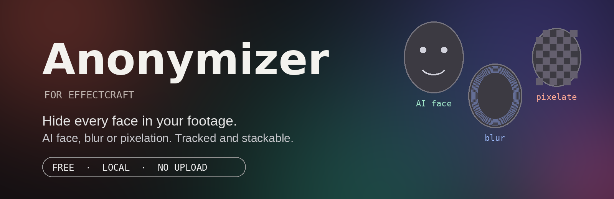
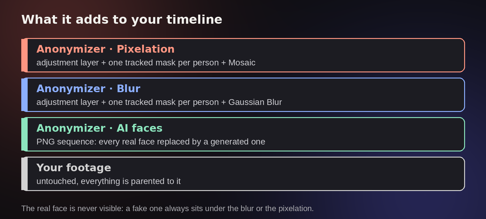
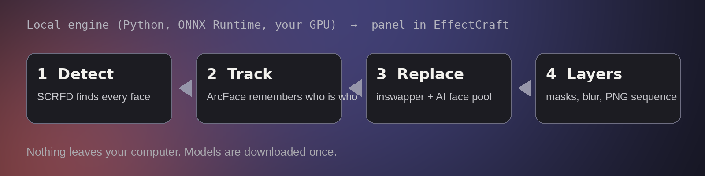

<b>Hide every face in your footage, in one click.</b> 
A fake AI face, a blur, a pixelation. Tracked, stackable, and fully local.

<a href="../../releases/latest"><b>⬇ Download</b></a> ·
<a href="README.fr.md">Français</a> ·
<a href="NOTICE.md">Model licences</a>

---

## What it does

Anonymizer is a panel for **[EffectCraft](https://github.com/storytold/effectcraft)** that finds **every face** in a clip, follows each person through the shot, and hides them. It is a rebuild of the idea behind aescripts' *Anonymizer*, made for EffectCraft.

- **AI face**: every person is replaced by a generated face of the same gender and a similar age. Expressions, lighting and motion are kept. A person keeps the same fake face for the whole shot, even if they leave the frame and come back.
- **Blur**: a Gaussian Blur follows each face through a tracked mask.
- **Pixelation**: a TV-style mosaic follows each face, with adjustable block size.
- **They stack.** And when you tick blur or pixelation, **a fake face is always slipped underneath**, so the real face is never visible, even if you later lower or remove the blur.

Everything it creates is a normal layer, parented to your footage, and editable: move a mask, delete the one of a person who doesn't need to be hidden, change the blur from the effect controls. The whole operation is one Ctrl+Z.

## How it works

EffectCraft scripts cannot run programs, so the tool has two parts:

| Part | Role |
|---|---|
| `Anonymizer.jsx` | The panel inside EffectCraft. Builds the layers, masks and effects. |
| `moteur/` | A local Python engine (ONNX Runtime, DirectML/CUDA/CPU). Detects, tracks and generates the faces. The panel talks to it on `127.0.0.1:47811`. |

**Nothing leaves your computer.** Models are downloaded once on install.

It works on stock EffectCraft. It does not modify the app in any way.

## Install (Windows)

1. Install **Python 3.10 to 3.13** from [python.org](https://www.python.org/downloads/) (tick *Add python.exe to PATH*).
2. Download the latest release zip, unzip it, and copy the `moteur` folder to `Documents\Anonymizer\moteur`. Avoid `Program Files`.
3. Double-click `installer.bat`. It installs the libraries and downloads the AI models (about 1.1 GB, once). Your graphics card is used through DirectML (NVIDIA, AMD or Intel); without one it falls back to the CPU.
4. In EffectCraft: **File ▸ Scripts ▸ Install ScriptUI Panel…** and pick `Anonymizer.jsx`. For bounded sliders, also copy `Plug-ins/AnonymizerControls.wasm` to EffectCraft's `Plug-ins` folder and restart (optional: without it, the panel uses plain sliders).
5. In EffectCraft **Settings ▸ Scripting & Expressions**, tick **Allow Scripts to Write Files and Access Network**. The panel cannot reach the engine without it.

macOS and Linux: use `installer.sh`, then `demarrer_moteur.command` (macOS) or `demarrer_moteur.sh`. Run `chmod +x *.sh *.command` first.

## Use it

1. Double-click `demarrer_moteur.bat` and keep the window open.
2. Open **Window ▸ Anonymizer.jsx** and press **Check**. It should say *Moteur connecté*.
3. Select your video layer, tick the methods you want, and press **Anonymiser**.

> **Tip:** try the **Zone de travail** option on 2 or 3 seconds first.

On shots longer than 150 frames the panel does not freeze EffectCraft: hover the panel or press *Vérifier* to follow progress, and the layers are created when the work ends.

## Speed

Version 1.1 added a **fast mode** (on by default, in the *Détection* tab):

- faces are detected every second frame and the frames in between are interpolated;
- under a blur or pixelation, the AI face is recomputed every third frame and re-pasted on the tracked position in between, and the HD restoration (useless there) is skipped;
- under a blur or pixelation, a heavily blurred patch of the original face area is also laid under the fake face, so even if the swap misses a face (cut by the frame edge, profile, tiny), no real detail is left under the blur;
- PNG files are written in parallel while the next frame is being computed.

On a 30-frame test with four people, on CPU only, the whole job went from **167 s to 59 s** with the same result. With the old default (HD restoration on) the same test took **392 s**, so the saving is about **6.5×**. A GPU is much faster still.

## Good to know

- **Formats**: the engine reads video with OpenCV (H.264, HEVC, ProRes, VP9, AV1…) and PNG, JPEG, TIFF or BMP sequences. It works on the source file, so effects applied to the layer are not taken into account.
- Time remapping is not supported. Time stretching and trimming are.
- A missed face (small, blurry, in profile)? Raise **Sensibilité** or lower **Visage minimal** in the *Détection* tab.
- Drop your own portraits (one face per image) in `moteur/faces/` to use them as replacement faces.
- The engine can run on its own, for testing:
  `python anonymizer_engine.py run --input clip.mp4 --swap --detect-stride 2`

## Licences

The code is **MIT**. The face detection and swap models are published by InsightFace for **non-commercial research use**. See [NOTICE.md](NOTICE.md) before using this in a commercial project.

Please use Anonymizer to **protect** the people you film, never to impersonate anyone.
